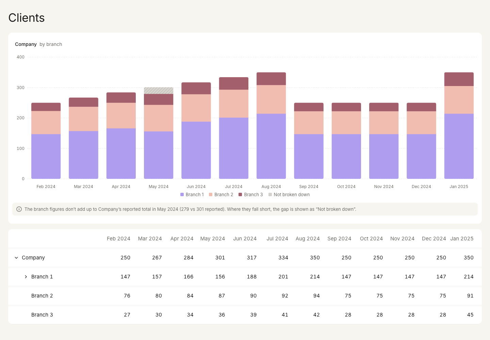

# Nevis Home Assignment

A dashboard of how a company's client base develops over 12 months: a stacked bar chart above an expandable table
that drills from the company down to branches, advisors and acquisition channels. A Node.js REST API serves the data.

**Live demo:** https://nevis-home-assignment.vercel.app



## Running it

Requires Node.js 20+ and npm. The repo is an npm workspace with `server/` and `web/`.

```bash
npm install
npm run dev          # API on :3001, web on http://localhost:5173
npm run build && npm start   # production build, one process on http://localhost:3001

npm test             # server and web tests
npm run lint         # ESLint, Steiger (FSD) and Prettier
npm run typecheck
```

Locally, `?delay=3000` or `?fail=1` on the page URL shows the loading skeleton or the error state.

## Tech stack

React 19, TypeScript, Vite and CSS Modules on the web; Express 5 on the server.

- **TanStack Query:** server state, retries and Suspense, so loading and error states live in boundaries.
- **Zustand:** the small UI state the chart and table share (expanded rows, selected row).
- **TanStack Table + Virtual:** a headless tree model, so the markup can be a proper ARIA treegrid, virtualized
  against the window scroll.
- **Recharts:** stacked bars with custom shapes and a built-in keyboard layer.
- **Motion:** row expand and collapse animations that respect `prefers-reduced-motion`.
- **Zod:** validates the API response at the boundary.
- **Vitest, Testing Library, Supertest:** UI tests through roles and the keyboard, and API tests.

`web/` follows [Feature-Sliced Design](https://feature-sliced.design) (`app` → `pages` → `entities` → `shared`),
enforced by [Steiger](https://github.com/feature-sliced/steiger). The components in `shared/ui` (`TreeTable`,
`StackedBarChart`, …) are controlled and know nothing about clients.

## Changes from the design

**The chart stacks the level below the selected row, so it has breadcrumbs.** The design stacks the whole company by
acquisition channel, but channel data only exists for one advisor, Anna Blackwood, so that split can't be drawn
truthfully. Instead, the chart shows the selected row split by its children: the company by branch, a branch by
advisor, an advisor by channel. Selecting Anna gives exactly the design's chart. The breadcrumb above the chart
shows where you are and takes you back up.

**Figures that don't add up are flagged, not hidden.** In seven places, a parent doesn't equal the sum of its
children. The data is shown as given. A shortfall is drawn as a hatched "Not broken down" segment, so each bar still
reaches the reported total. The chart header shows how many months don't add up, and opens the details.

**Smaller calls.** Rows without children have no chevron, although the design shows one on Branches 2 and 3. Advisors
without a photo get initials. The API adds a `months` array, because the payload has no dates.

## Selection

The prototype only expands and collapses rows; its chart never changes. To drill the chart as well, the table drives
it: **the row you click or move to with the keyboard becomes the chart's subject**, and a click still expands or
collapses it as in the prototype. This keeps the design's interaction and needs no extra controls. The costs:

- **One click does two things.** Clicking an open row to chart it also collapses it. The breadcrumb goes back up
  without touching the table.
- **The chart follows keyboard focus,** so it redraws on every arrow key.

Other ways to do it:

- **Separate the actions.** A row click charts the row, and the chevron expands or collapses it. Arrow keys only move
  focus, and Enter charts. This is cleaner, but differs from the prototype.
- **Drill from the chart.** The table stays exactly as designed, and clicking a legend entry drills the chart.
- **Make it configurable in `TreeTable`,** with separate props for selection and activation, so each screen picks
  its behaviour.

## What the data and design get wrong

While checking the totals I found a few things that look off.

Maria Gutierrez has 22 clients in May, which doesn't fit the rest of her series (36, 39, 41, then 22, then 46). The
company's May total is short by exactly 22. If her May were 44, her series, Branch 1 and the company would all line
up, so I suspect a typo in her figure.

Robert Chen's August is 58 in the data but 56 in the design, and 56 is the number that makes Branch 1 add up.

Anna's "New paid" row looks like it's one month late. Moving it back a month fixes all five of her months that don't
add up.

The design shows 291 for Branch 1 in July, but the data says 201. 201 fits the trend, so I think the design has a
typo.

September to December are flat for every row, and then January jumps back to the August level. That looks like
placeholder data to me rather than real numbers.

## Open questions and next steps

A few things I'd want to ask:

- Do you actually need the whole company split by acquisition channel? That would need channel data for every
  advisor, not just Anna.
- When the data and the design disagree, which one should I trust?
- Can a parent have clients that aren't assigned to any of its children? I assumed yes, which is why a shortfall
  shows up as "Not broken down" instead of an error.

If I had more time, I'd test the selection behaviour with real users before settling on it, and agree with the data
owners on how the totals should reconcile. On the technical side, I'd share the API types between server and web,
give the chart and the table their own error boundaries, keep the current view in the URL so it can be shared, and
add Playwright tests with axe checks.
